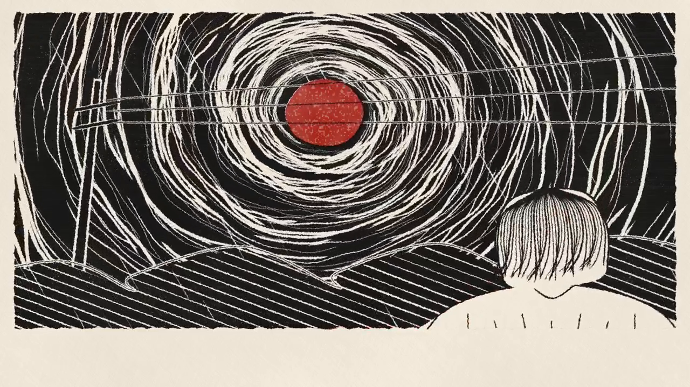

# smooth-animation

A Claude Code skill that makes animations generated in code play smoothly (HyperFrames, Remotion, canvas, three.js), plus a small meter that tells you why a video looks choppy.

[](demo/demo-60fps.mp4)

**[Watch the demo (20 s, 720p, 60 fps, with sound)](demo/demo-60fps.mp4).** The on-screen caption is in Portuguese.

## The idea

When each frame is a pure function of time, the in-between frames can be **drawn**, not guessed. Choppy output is rarely a lack of frames. It is usually irregular motion or low sampling, so the skill works in this order:

1. Measure the file.
2. Fix the motion: no still scenes, and a camera on smooth curves instead of frame-by-frame noise.
3. Render at a real 60 fps, with motion blur from 3 samples.
4. Measure the final file again.

AI frame interpolation such as RIFE is left for footage that is already recorded.

## Install

Clone it into your Claude Code skills folder:

```bash
git clone https://github.com/Flchntc/smooth-animation-skill ~/.claude/skills/smooth-animation
```

Claude loads it when an animation looks choppy, or when you ask for smoother motion or 60 fps. The clone includes the 20 MB demo clip.

## The meter

It needs Python 3 and `ffmpeg`/`ffprobe` on the PATH, with no other dependencies:

```bash
python scripts/measure_smoothness.py video.mp4
```

| Check | What it means | Likely cause |
|---|---|---|
| `repeated` | frames identical to the previous one | the render or encode lost frames |
| `still` | at least 0.5 s with no motion | the scene itself is static |
| `jitter` | the amount of motion swings between frames | a noisy camera |

Add `--json` for machine-readable output. The exit code is 1 if it finds a defect.

## Results on the demo

- **Demo file:** 60 fps, 1200 frames, and PASS on all three checks.
- **Camera fix:** on a spiral shot from the same film, with both versions at 60 fps, the frame-to-frame variation in motion fell from 36% to 7% after replacing camera noise with smooth curves.

## Results on a slow stroke filter

A second test, on a vertical woodcut film whose look comes from a slow stroke filter over a 3D render. Same film and same sections, before (30 fps, filter recut 12 times per second) and after (60 fps, blended recuts, smooth camera, 3-sample blur). Lower `jump` is better, and the limit is 0.1. [Watch the side-by-side clip](demo/woodcut-before-after.mp4) (10 s, silent, before on the left).

| Section (2 s each) | Before | After |
|---|---|---|
| Portrait over moving water | jump 1.15 and 2.09, `jitter` FAIL | jump 0.01 and 0.11, `jitter` FAIL by a hair on 1 s |
| Static icon | still for 1.14 s, `still` FAIL | no still stretch |
| River, 3D with stroke filter | jump 2.39 and 2.54, `jitter` FAIL | jump 0.19 and 0.20, still `jitter` FAIL, about 13 times lower |
| Slow scene, already fine | jump 0.01, PASS | jump 0.01, PASS |
| Text card | still for 0.5 s, `still` FAIL | no still stretch, after adding drifting specks |

Caveats: 5 short sections from one film, and the numbers don't prove how it feels to a viewer. The heaviest section still fails the meter, and each 2 s test took about 2 minutes to render, startup included.

## Limits

- The thresholds come from a small test set of 5 videos, so treat them as a starting point.
- A PASS does not prove how the video feels to a viewer. A small element moving on a still background can also pass the `still` check, so watch the scenes too.

## License

The skill and the script are under the [MIT license](LICENSE).

The `demo/` folder is **not**. It holds an unofficial, non-commercial fan animation inspired by *Uzumaki* by Junji Ito, included only to demonstrate the technique, and a clip from the author's own woodcut film (all rights reserved). See [demo/NOTICE.md](demo/NOTICE.md).
